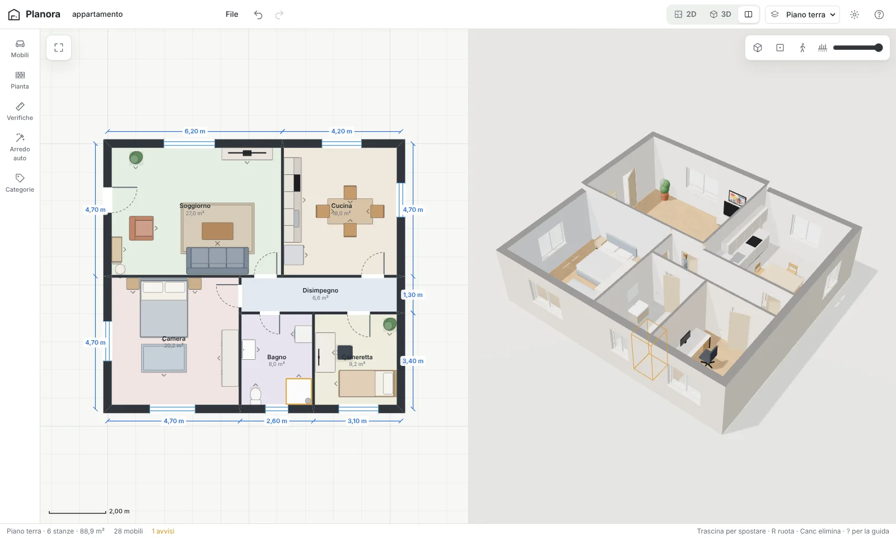
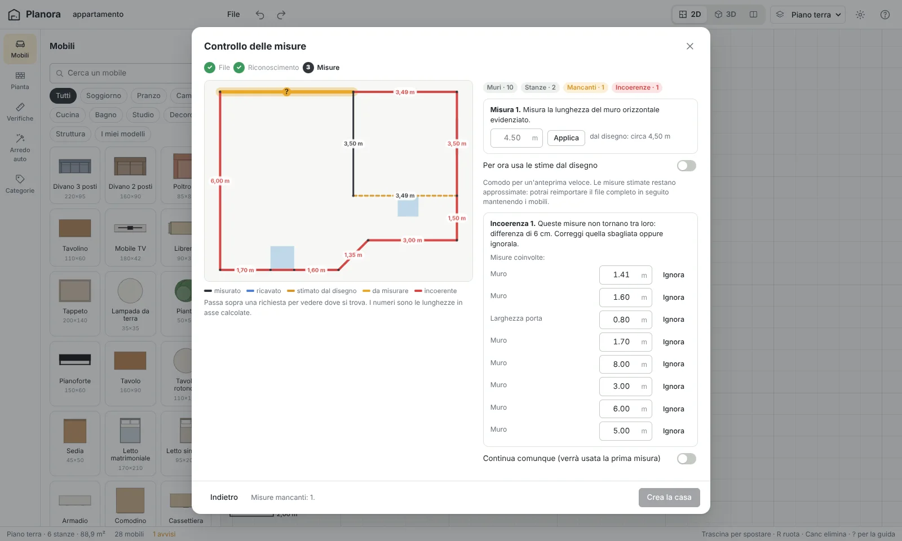
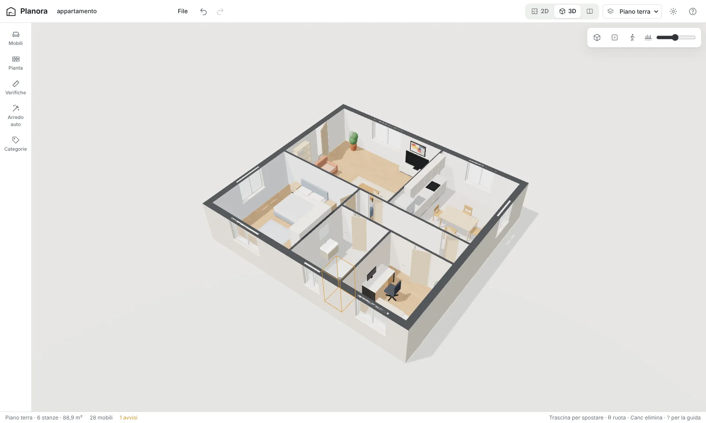
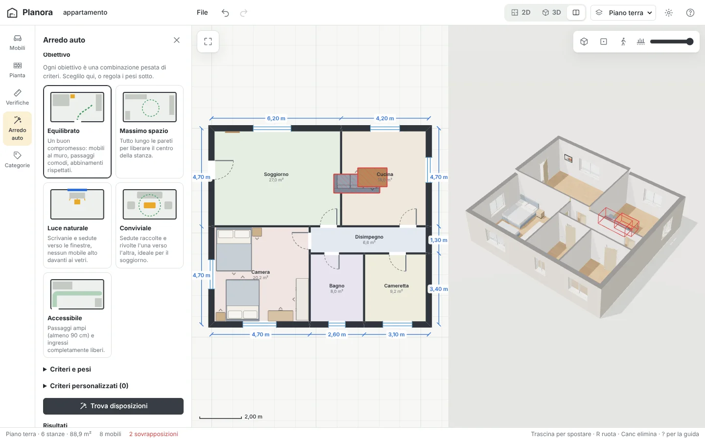
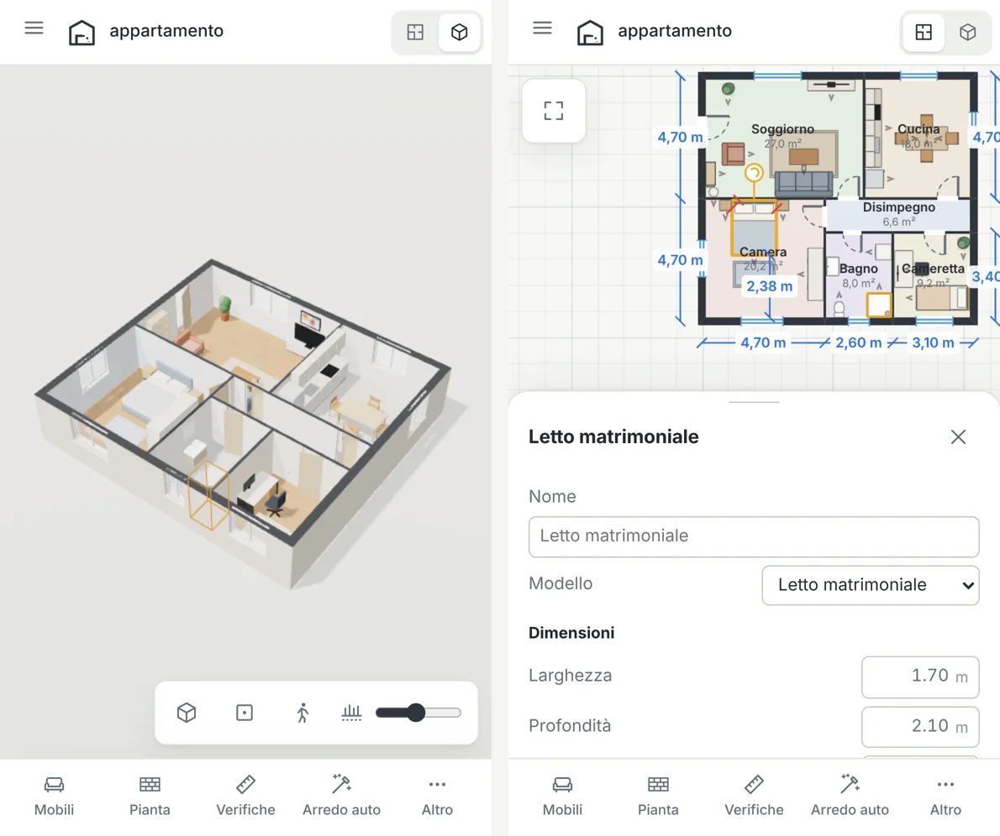

<div align="center">


# Murello

**From a draw.io floor plan to a furnishable 3D house — right in the browser.**

Draw your home in [draw.io](https://app.diagrams.net), write the lengths on the walls, import it,
and try out furniture before you buy it: check sizes, walkways and how it will actually look.

[**Open the app**](https://follen99.github.io/Murello/) · [Try the example](https://follen99.github.io/Murello/?example=appartamento) · [Leggi in italiano](README.it.md)




</div>

---

## What it does

- **Imports draw.io plans** (`.drawio` / `.xml`, compressed or not, multi-page = multi-floor). Rooms can be rectangles, walls can be lines or polylines, doors and windows can come from draw.io's *Floorplan* library.
- **Treats your measurements as the truth.** The drawing only gives the topology; the lengths you type on the walls give the real geometry. Murello tells you **which wall you still need to measure** and **which lengths don't add up** — before building anything.
- **Shows the house in 2D and 3D** with soft shadows, textured floors, framed windows, doors with leaves, and a wall-cut slider to look inside like a dollhouse.
- **Lets you edit walls in 3D**: click a wall to add windows, doors, openings, pictures, shelves, a TV, radiators, mirrors… on the side you clicked, at the point you clicked.
- **Furniture library + model editor.** 36 parametric models (sofas, beds, kitchens, bathroom…), every one resizable. Create your own from blocks and cylinders, with expressions like `w/2 - 0.05`, or from a top-view sketch drawn in draw.io.
- **Checks space for you**: overlaps, furniture inside walls, blocked door swings, covered windows, live distances to the nearest obstacle while you drag, a tape measure, and a walkway map.
- **Auto-furnish**: picks positions for a room's furniture by optimising a weighted objective — five illustrated presets, adjustable weights, and your own criteria in JavaScript.
- **Saves and round-trips**: autosave in the browser, native `.murello.json` export/import, and **export back to draw.io** so you can keep editing the plan there and re-import it without losing furniture.
- **Desktop and mobile**: the interface detects the device and turns device-specific features on or off.

Everything runs locally in the browser. No account, no server, no upload.

## How it works

```
draw.io ──► import ──► recognition ──► measurement check ──► 2D + 3D house ──► furniture, checks, auto-furnish
   ▲                                                                                     │
   └──────────────────────────── export to draw.io  ◄──── .murello.json ◄────────────────┘
```



### 1. Draw it in draw.io

| You draw | Murello reads it as |
|---|---|
| A **line** or polyline | a wall (a line with arrows on both ends is a **dimension**) |
| A **rectangle** | a room; its sides become walls |
| `3.40`, `3,40`, `340 cm`, `3m40` on a line (double-click it) | the wall length |
| `Kitchen 4x3.5` inside a room | name + width × depth |
| `h=2.70` | room or wall height |
| `sp=30` | wall thickness (30 cm) |
| A plain text with only a number next to a wall | the length of that wall |
| draw.io *Floorplan* doors, windows, beds, sofas… | doors, windows, furniture |
| A text `murello: misure=asse h=2.7 est=30 int=10` | file-wide options (measure mode, height, outer/inner thickness) |
| Every **page** | one floor of the house |

Numbers without a unit are read automatically: `340` → centimetres, `3.4` → metres (configurable).

### 2. Import and check the measurements

The solver snaps wall ends into corners, splits walls at T-junctions, then solves **X and Y separately** with a weighted union-find (orthogonal walls make the problem linear; slanted walls are resolved as soon as one projection is known). Every measure — wall labels, room `W×D`, dimension lines, nearby texts, door widths, your answers — becomes a constraint between two corners.

- **Missing lengths**: if part of the plan isn't tied to the rest, Murello highlights the exact wall to measure (choosing outer and longer walls first) and shows the estimate from the drawing. You can also accept the estimates for a quick preview.
- **Inconsistent lengths**: when a loop of measures doesn't close (e.g. `1.70 + 0.80 + 1.60 + …` ≠ `8.00`), it lists every length involved so you can fix or ignore the wrong one.
- **Clear vs centre-line**: by default lengths are *clear* (between wall faces, what you get with a tape measure); half wall thicknesses are added automatically. Switch to *centre-line* in the wizard or in the file.

### 3. Unknown shapes: ignore or categorise

Shapes Murello doesn't know can be **ignored** (if one interrupts a wall, the wall is closed and you add the door later in 3D) or **assigned a category** (wall, room, door, window, opening, furniture, column, stairs, dimension, text). Tick *Remember* and it becomes a rule.

## Categories and rules (extensible without touching the code)

Rules map draw.io shapes to building elements. Your rules run before the built-in ones. Create them in **Categories** with a form…

```text
Name: Radiator      When: Shape is "mxgraph.floorplan.radiator"     Becomes: Furniture (model: radiator, height 0.6, 0.12 above floor)
```

…or, for full flexibility, with a JavaScript predicate (it runs only on your device):

```js
// cell: { shape, style, label, attrs, isEdge, width, height }
return cell.shape.includes('fireplace') || /camino/i.test(cell.label);
```

Rules, furniture models and auto-furnish criteria travel together in a shareable **library file** (`murello-libreria.json`). Code coming from imported files stays disabled until you review and approve it.

To add a brand-new *kind* of element in code, register it in [`js/categories/registry.js`](js/categories/registry.js) (`KINDS`) and teach [`js/io/plan-extract.js`](js/io/plan-extract.js) how to read it.

## Furniture

Models are plain data, so built-in models, your models and imported ones share one format:

```js
{
  id: 'bench', name: { it: 'Panca', en: 'Bench' }, cat: 'custom', color: '#b8875a',
  params: { w: 1.2, d: 0.35, h: 0.45 }, tags: ['wall', 'seat'],
  parts: [
    { s: 'box', x: 0, y: 'h-0.04', z: 0, w: 'w', h: 0.04, d: 'd', r: 0.01, m: 'main' },
    { rep: 'max(2, round(w/0.6))', s: 'box', x: '-w/2 + w/n*(i+0.5)', y: 0, z: 0, w: 0.04, h: 'h-0.04', d: 'd-0.04', m: 'dark' }
  ]
}
```

- `s`: `box` (rounded with `r`), `cyl` (optional taper `tp`, `ax: 'z'` to face forward), `sph`.
- `x`, `z` from the centre of the footprint, `y` from the floor; `w h d` sizes. Any field can be an expression of `w d h` (item size), `H` (floor height), `i n` (repeat index/count) with `min max round floor ceil abs sqrt sin cos atan PI` — expressions are whitelisted, not `eval`'d freely.
- Materials: `main` (item colour), `soft`, `accent`, `wood`, `dark`, `white`, `metal`, `black`, `glass`, `ceramic`, `mattress`, `leaf`, `pot`, `counter`, `screen`.
- Tags drive the checks and auto-furnish: `wall`, `tall`, `seat`, `light`, `low`, `center`, `small`, `hanging`, `flat`.

The in-app editor previews the model live in 3D and from above. It can also start from a **draw.io top-view sketch**: every rectangle/ellipse becomes a part, proportional to the overall size (`120x60` in a label sets the scale, `h=0.75` the height).

## Checks

- **Overlaps** (with height: a wall cabinet above a base unit is fine; a chair tucked under its table is fine), **inside a wall**, **blocking a door swing**, **covering a window**, **outside the rooms**.
- **Automatic distances** from each side of the selected item to the nearest wall or item, coloured by your *minimum* (default 60 cm) and *comfortable* (90 cm) walkway — in 2D and 3D.
- **Tape measure** snapping to corners and wall faces, in 2D and 3D.
- **Walkway map**: floor reachable from the doors by a person as wide as the minimum walkway (green) versus free but unreachable space (red).



## Auto-furnish

The optimiser runs in a **Web Worker** (the page stays responsive) and uses simulated annealing with domain moves — snap to a wall, place next to a partner (nightstand beside the bed, chairs around the table, sofa facing the TV), swap, rotate, jitter. It maximises

```
J = Σ wᵢ · (±termᵢ) − 60 · constraints
```

where every built-in term returns a value in `[0, 1]`, `+` for *maximise*, `−` for *minimise*, and the constraints are overlaps, being outside the room and blocking door swings.

| Term | Rewards |
|---|---|
| Clear walkways | floor reachable from doors with the minimum walkway |
| Open centre | one large free area |
| Furniture against walls | backs of `wall` items touching a wall |
| Near windows | desks, tables, seats close to daylight |
| Blocked windows (min) | tall furniture in front of windows |
| Pairings | nightstand↔bed, chairs↔table, sofa↔TV, chair↔desk |
| Conversation | seats facing each other at 1.2–3.5 m |
| Visual balance | weight spread around the room centre |
| Clear entrances | a free strip in front of each door |
| Spread (min) | furniture grouped together |

Presets — **Balanced**, **Maximum space**, **Daylight**, **Social**, **Accessible** (90 cm walkways) — each come with an illustration and set the weights; you can then tune every slider or flip max/min. Add your own criteria in JavaScript and test them on the current room:

```js
// Keep the TV away from windows (reflections). Return 0..1, higher is better.
const tv = ctx.items.find(i => i.model.startsWith('tv'));
if (!tv || !ctx.windows.length) return 1;
const d = Math.min(...ctx.windows.map(w => h.dist(tv, w.center)));
return h.clamp01(d / 4);
```

You get up to three different proposals with a per-term score breakdown, previewed live; *Use this one* applies it (and Undo reverts it).



## Desktop and mobile



The device is detected from the pointer and screen size (it can be forced in Settings). Some features exist only where they make sense:

| Feature | Desktop | Mobile |
|---|:-:|:-:|
| 2D and 3D side by side | ✓ | |
| Keyboard shortcuts, hover highlight, right-click menu | ✓ | |
| Drag furniture from the library onto the plan | ✓ | |
| Bottom-sheet panels and inspector | | ✓ |
| Two-finger furniture rotation (snaps every 15°) | | ✓ |
| Haptic feedback when snapping | | ✓ |
| Lighter shadows and pixel ratio on low-power devices | | ✓ |

Shortcuts: `1` `2` `3` views · `R` rotate · `Del` delete · `Ctrl+D` duplicate · arrows nudge 1 cm (`Shift` 10 cm) · `M` tape measure · `W` draw walls · `F` fit · `Ctrl+Z`/`Ctrl+Y` · `Ctrl+S` export · `Space`+drag pan · `Alt` while dragging disables snapping · `?` help.

## Saving and file formats

- **Autosave** in `localStorage` (project, library and settings stay on the device).
- **`.murello.json`** — the full project (floors, walls with openings and decor, rooms, furniture, custom models used). Re-import it to continue exactly where you left off.
- **draw.io export** — one page per floor, lengths written on the walls (centre-line), doors/windows as Floorplan shapes, furniture as labelled shapes. Murello-specific data is stored in custom properties (`murello_kind`, `murello_data`, visible in draw.io under *Edit ▸ Edit Data*), so draw.io → Murello → draw.io is lossless. When you re-import an updated plan you can choose to **update only the walls and keep the furniture**.

## Publish on GitHub Pages

1. Create a public repository (e.g. `murello`) and push these files to `main`.
2. *Settings ▸ Pages ▸ Build and deployment*: **Deploy from a branch**, branch `main`, folder `/ (root)`.
3. Open `https://follen99.github.io/Murello/`.

There is no build step: the site is plain ES modules plus a vendored, minified three.js. `.nojekyll` keeps GitHub from processing the files.

## Run locally

```bash
python3 -m http.server 8080      # any static server works; ES modules need http://, not file://
# open http://localhost:8080
```

Tests (parser, solver, round trips) run in Node:

```bash
npm install     # only installs linkedom, a DOM parser for Node
npm test
node tests/debug-solve.mjs examples/bilocale-misure-mancanti.drawio   # print what the solver sees
```

## Project structure

```
index.html              app shell, icon sprite, import map
css/app.css             design tokens, desktop + mobile layouts, light/dark
js/main.js              app: views, panels, actions, shortcuts, autosave
js/core/                state + undo/redo, i18n (IT/EN), device flags, geometry, persistence
js/io/                  draw.io parser, label parsing, plan extraction, measurement solver,
                        project builder, draw.io export, native format
js/categories/          element kinds and recognition rules
js/model/               derived geometry: mitred walls, rooms (planar faces), areas
js/view2d/              canvas 2D plan (editing, snapping, dimensions, walkway map)
js/view3d/              three.js viewer (render on demand), wall/floor/opening/decor builders, materials
js/furniture/           parametric library, safe expressions, mesh builder
js/tools/               collisions, clearances, door swings, snapping, walkability grid
js/autofurnish/         objective terms + presets, room context, optimiser worker
js/ui/                  import wizard, inspector, panels, rules, model editor
vendor/three/           three.js r186 (MIT), minified
examples/               sample draw.io files
tests/                  Node tests
```

## Why these technologies

- **Vanilla JS + ES modules, no framework, no build**: push and it's live; easy to read and change.
- **three.js** for WebGL, vendored (~200 kB gzipped, the largest part of the site) and **loaded lazily**: the 2D plan works before it arrives.
- **Render on demand**: the 3D view draws only when something changes, so an idle page costs nothing.
- Merged geometry: all walls of a floor are one mesh; each furniture item is one mesh per material.
- **Procedural textures** (canvas) instead of image downloads.
- The optimiser runs in a **Web Worker**.

## Privacy

Files are read in the browser and never uploaded. The only network requests are the site's own files and the Google Fonts stylesheet for the UI typeface (remove the `<link>` in `index.html` to use the system font).

## Roadmap ideas

Walk-through first-person mode · curved walls · roofs and sloped ceilings · stairs connecting floors · glTF import for furniture · sharing a read-only link.

## License

[MIT](LICENSE). three.js is © three.js authors, MIT licensed ([vendor/three/LICENSE](vendor/three/LICENSE)).
